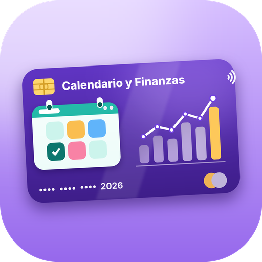
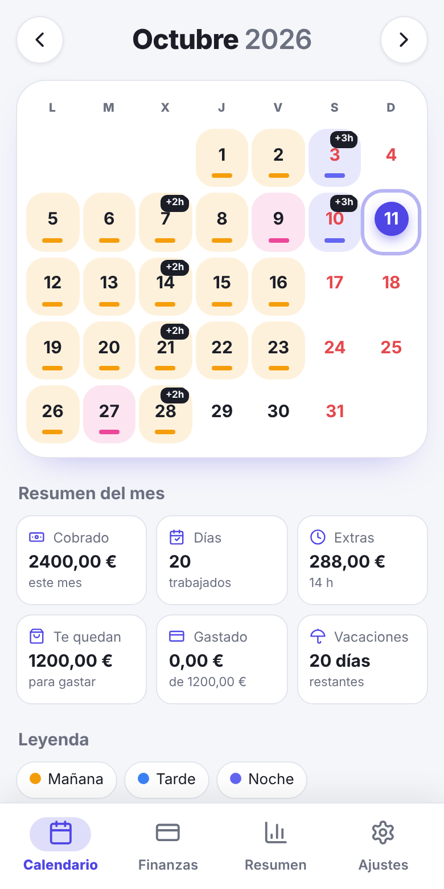
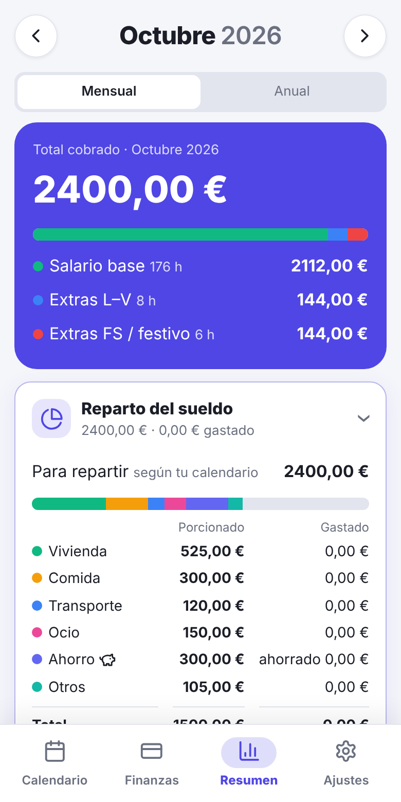
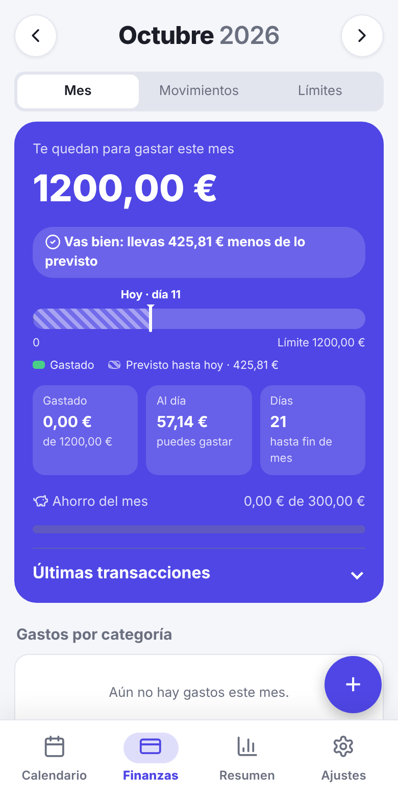
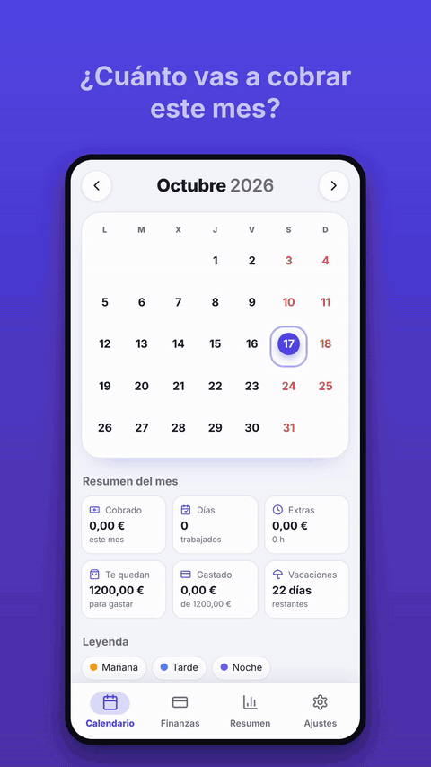

<h1 align="center">Mi Calendario Laboral y Finanzas</h1>

Tu calendario de turnos, tus horas extra y tu sueldo, todo en el móvil. Sin cuentas, sin anuncios y sin enviar tus datos a ningún sitio.

<i>Your shift calendar, overtime and pay, all on your phone. No accounts, no ads, and your data never leaves your device.</i>

 <a href="docs/demo.mp4">Ver en vídeo (MP4) · Watch the MP4</a>

🇪🇸 <b>Español</b> (aquí abajo) · 🇬🇧 <a href="#english"><b>English</b></a> (<a href="#english">go to the English section</a>)

## Qué puedes hacer

- **Calendario de turnos:** marca tus días (mañana, tarde, noche, vacaciones, festivos…) con colores y hora de entrada y salida.
- **Horario fijo o rotativo:** configúralo una vez y el calendario se rellena solo.
- **Horas extra y descansos:** la app calcula las horas y lo que cobras, entre semana y en fin de semana.
- **Sueldo y reparto:** mira lo que llevas cobrado y cómo repartirlo (vivienda, comida, ahorro…).
- **Finanzas:** apunta gastos e ingresos extra (pagas, regalos…) y ve cuánto te queda para gastar.
- **Festivos:** impórtalos desde Google Calendar.
- **6 idiomas:** español, inglés, portugués, francés, alemán e italiano, o automático según tu móvil. Se cambia desde una pantalla con banderas.
- **Unas 50 monedas:** euro, dólar, pesos, libra, real… con buscador y las más usadas arriba. Los importes se escriben con el formato de cada idioma.
- **A tu gusto:** tema claro u oscuro, color principal, tamaño del texto y semana que empieza en lunes o domingo.
- **Copias de seguridad:** automáticas y también en texto o archivo para guardarlas donde quieras.
- **Actualizaciones desde la app:** en Ajustes → Actualizaciones, sin reinstalar nada.

## Novedades

**1.5**
- Ingresos extra: en Finanzas, botón «+» → Ingreso, para apuntar dinero que te dan fuera de tu salario. Suma a lo que te queda para gastar y sale en verde en Movimientos.

**1.4**
- Nuevos idiomas y monedas, con selector propio en Ajustes.
- Las horas del día solo se piden en los días trabajados.
- Importar festivos y buscar actualizaciones funcionan también dentro de la app ya actualizada.
- Puedes elegir de qué rama actualizar (`main` o `prueba`) con un desplegable.

## Instalar en Android

1. Entra en la pestaña **Releases** de este repositorio y descarga el archivo `.apk` más reciente.
2. Ábrelo en el móvil y permite instalar desde fuentes desconocidas si te lo pide.
3. Para actualizar más adelante, usa **Ajustes → Actualizaciones → Buscar actualización**.

## Tus datos

Todo se guarda **solo en tu móvil**. Haz una copia de seguridad antes de desinstalar la app o cambiar de teléfono (Ajustes → Datos).

---

## English

**My Work Calendar & Finance** is a personal Android app that keeps your shifts, overtime, pay and everyday spending in one place. No accounts, no ads, and your data never leaves your phone.

### What you can do

- **Shift calendar:** mark each day (morning, afternoon, night, holiday…) with colours and start and end times.
- **Fixed or rotating schedule:** set it once and the calendar fills itself in.
- **Overtime and breaks:** hours and pay are calculated for weekdays and weekends.
- **Pay and budget split:** see what you have earned and how to divide it (housing, food, savings…).
- **Finance:** log expenses and extra income (bonuses, gifts…) and see what is left to spend.
- **Holidays:** import them from Google Calendar.
- **6 languages:** Spanish, English, Portuguese, French, German and Italian, or automatic from your phone.
- **About 50 currencies:** with search and the most used ones on top.
- **Your style:** light or dark theme, accent colour, text size and week start.
- **Backups:** automatic, or as text or a file you can keep anywhere.
- **In-app updates:** Settings → Updates, no reinstalling.

### Install on Android

1. Open the **Releases** tab of this repository and download the latest `.apk`.
2. Open it on your phone and allow installs from unknown sources if asked.
3. To update later, go to **Settings → Updates → Check for updates**.

### Your data

Everything is stored **only on your phone**. Make a backup before uninstalling the app or switching phones (Settings → Data).

---
La app es un único archivo `index.html` empaquetado como APK con Capacitor y compilado automáticamente con GitHub Actions.
